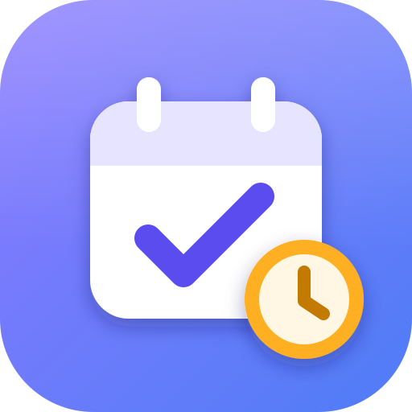
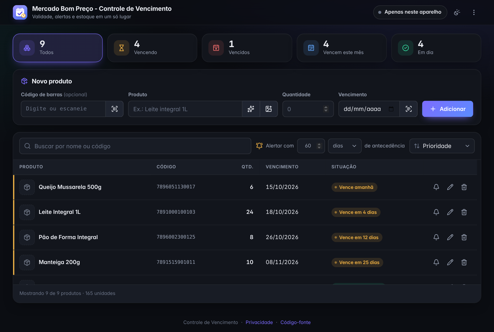
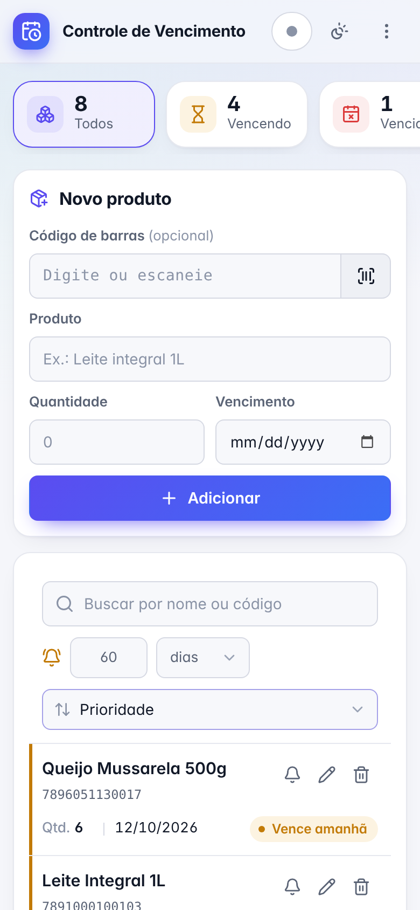
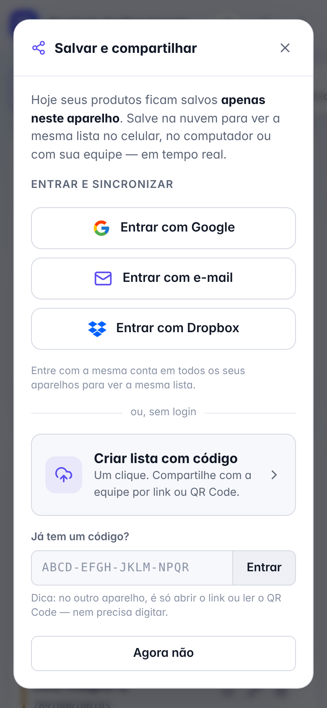

# Controle de Vencimento

**Controle a validade dos seus produtos, receba alertas antes do vencimento e use a mesma lista em todos os seus aparelhos.**

[**▶ Abrir o app**](https://rudagabriel.github.io/) · [Privacidade](https://rudagabriel.github.io/privacidade.html) · [Reportar problema](https://github.com/RudaGabriel/rudagabriel.github.io/issues)

Gratuito · Funciona no celular e no computador · Sem instalação · Sem cadastro obrigatório

---

## Sumário

- [O que é](#o-que-é)
- [Destaques](#destaques)
- [Capturas de tela](#capturas-de-tela)
- [Primeiros passos](#primeiros-passos)
- [Cadastrar produtos](#cadastrar-produtos)
- [Ler a data de validade por foto](#ler-a-data-de-validade-por-foto)
- [Ler código de barras](#ler-código-de-barras)
- [Acompanhar os vencimentos](#acompanhar-os-vencimentos)
- [Editar e remover](#editar-e-remover)
- [Salvar na nuvem e usar em vários aparelhos](#salvar-na-nuvem-e-usar-em-vários-aparelhos)
- [Compartilhar com a equipe](#compartilhar-com-a-equipe)
- [Backup e planilha](#backup-e-planilha)
- [Personalizar](#personalizar)
- [Nome da sua loja](#nome-da-sua-loja)
- [Instalar como aplicativo](#instalar-como-aplicativo)
- [Privacidade](#privacidade)
- [Onde funciona](#onde-funciona)
- [Tecnologias e bibliotecas](#tecnologias-e-bibliotecas)
- [Perguntas e problemas comuns](#perguntas-e-problemas-comuns)

---

## O que é

O **Controle de Vencimento** ajuda a não perder produtos por validade. Ele foi pensado para mercados, farmácias, padarias, depósitos e para a despensa de casa:

- cadastre os produtos (até lendo o código de barras com a câmera);
- veja na hora o que está **vencendo**, o que **já venceu** e o que vence **este mês**;
- receba um **alerta ao abrir o app** com o que está perto de vencer;
- se quiser, use a **mesma lista no celular e no computador**, ou com a sua equipe.

Por padrão, tudo fica salvo **no seu próprio aparelho**. Nada é enviado para a internet, a menos que você ative a nuvem.

## Destaques

| | Recurso | Por que importa |
|:---:|---|---|
| 📷 | **Leitor de código de barras** com flash, zoom e foto | Cadastro em segundos, inclusive no iPhone. |
| ⏰ | **Alertas de vencimento** com prazo ajustável | Você age antes de perder o produto. |
| 🧭 | **Resumo com filtros** (vencendo, vencidos, do mês, em dia) | Visão do estoque em um toque. |
| ☁️ | **Nuvem com Google, e-mail ou Dropbox** | A mesma lista no celular, no computador e na equipe. |
| 🔗 | **Compartilhamento por link ou QR Code** | A equipe entra sem criar conta, com acesso de edição ou só leitura. |
| 📶 | **Funciona sem internet** | Depois da primeira visita o app abre mesmo offline; tudo sincroniza quando a conexão voltar. |
| 🏪 | **Nome da sua loja** no topo do app, sincronizado na nuvem | O app com a cara do seu negócio, em todos os aparelhos. |
| 💾 | **Backup e planilha** (.json e .csv) | Seus dados sempre com você, abrindo no Excel ou no Google Planilhas. |
| 🌗 | **Tema claro e escuro**, layout responsivo | Confortável em qualquer tela, de 320 px a monitores largos. |
| 📲 | **Instalável como aplicativo** | Ícone na tela inicial, abrindo em tela cheia. |

## Capturas de tela

| Computador (tema escuro) | Celular (tema claro) | Salvar e compartilhar |
|:---:|:---:|:---:|
|  |  |  |

## Primeiros passos

1. Abra **[rudagabriel.github.io](https://rudagabriel.github.io/)** no navegador do celular ou do computador.
2. Em **Novo produto**, preencha o produto, a quantidade e o vencimento e toque em **Adicionar**.
3. Pronto: o produto aparece na lista com a situação ("Vence em 12 dias", "Venceu ontem"…).

Não é preciso criar conta. Se quiser guardar na nuvem, veja [Salvar na nuvem](#salvar-na-nuvem-e-usar-em-vários-aparelhos).

## Cadastrar produtos

| Campo | Obrigatório | Dica |
|---|:---:|---|
| **Código de barras** | Não | Toque no ícone ao lado do campo para ler com a câmera, ou digite. |
| **Produto** | Sim | O app sugere nomes que você já usou. |
| **Quantidade** | Sim | Aceita números grandes (ex.: 1.240). |
| **Vencimento** | Sim | Data de validade do lote. Toque no ícone ao lado para **ler a data por foto**. |

- **Nome automático:** se você ler um código de barras que já está na lista, o nome do produto é preenchido sozinho.
- **Nome sugerido:** depois de ler ou digitar o código, toque no botão **✨** do campo *Produto*. O app procura o produto em bases públicas (**Open Food Facts** — versão Brasil, em português — e outras) e mostra o nome encontrado, com marca e tamanho (ex.: *Leite UHT Integral Piracanjuba 1 L*) e a fonte. **Se houver mais de um nome** (bases diferentes, lojas e pesquisa na web), o app mostra **todas as opções**, cada uma com a sua fonte, para você escolher a que bate com a embalagem. **Nomes completos têm prioridade:** se uma base devolve um nome abreviado de cadastro (ex.: *CR TRAT NOVEX BABOSAO 1KG*), o app continua procurando nas outras bases e prefere o nome por extenso (*Creme de Tratamento Novex Babosão 1 kg*); o abreviado só é usado se não houver outro. Você escolhe **Usar este nome** ou **Cancelar**. Na **pesquisa na web**, só valem páginas que **citam o código de barras** — resultados aleatórios do buscador nunca viram nome de produto.
- **Código não encontrado?** O app procura os **nomes mais plausíveis**: produtos do **mesmo fabricante** com código vizinho (os fabricantes numeram os itens em sequência, então costumam ser o mesmo produto em outra versão) e produtos parecidos da sua própria lista. Mostra até 8 opções — **nomes completos primeiro**, da mais provável para a menos, e os abreviados no fim — para você **escolher** e ajustar. Se não houver nada parecido, aparecem atalhos para **pesquisar no Google** ou no **Cosmos (Bluesoft)**.
- **Sugestão automática (opcional):** no menu **⋮**, ligue **Sugerir nome automaticamente** para o nome ser preenchido sozinho ao ler um código novo. Vem **desligada**. Funciona com códigos de produtos (EAN/UPC) e precisa de internet.
- **Produto repetido:** ao cadastrar o mesmo produto com o mesmo vencimento, o app pergunta se você quer **somar** as quantidades ou **substituir** pela nova.
- Leitores de código de barras **USB ou Bluetooth** também funcionam: basta clicar no campo do código e ler.

## Funções experimentais

> **Atenção:** a **sugestão de nome** e a **leitura da data de validade** são **experimentais** e **não são totalmente precisas**. O app sempre mostra o resultado para você conferir — confira com a embalagem antes de salvar.

## Foto do produto

Cada produto da lista mostra uma **miniatura** ao lado do nome.

- **Automático:** quando o **código de barras é válido** (digitado ou lido pelo leitor), o app procura a foto sozinho — ela já aparece no botão de foto do formulário e entra com o produto. Produto **só com nome** não busca sozinho: toque no botão de foto (ou na miniatura) para buscar. A foto encontrada é baixada **uma vez** e guardada no aparelho. Dá para desligar em **⋮ → Buscar fotos automaticamente**.
- **Toque na miniatura** para ver a foto grande e:
  - **Tirar ou escolher foto** — use a câmera ou escolha uma imagem do celular/computador. A sua foto **sempre tem prioridade**;
  - **Buscar na internet** — mostra as fotos encontradas pelo nome e pelo código para você escolher;
  - **Remover foto** — o app não busca de novo para esse produto.
- No formulário, o botão de **foto** (ao lado do ✨) deixa escolher a foto antes de adicionar o produto.
- A foto vale para o **produto** (mesmo código de barras ou, sem código, mesmo nome): todos os lotes mostram a mesma foto.
- As fotos ficam **guardadas neste aparelho**. Em outro aparelho, a busca automática encontra de novo as fotos pelo código; fotos tiradas por você não vão para a nuvem.

## Ler a data de validade por foto

1. Toque no ícone ao lado do campo **Vencimento**. A câmera abre com uma **moldura**.
2. Deixe **só as linhas da data** dentro da moldura, bem de perto e com luz, e toque em **Ler data**. Se a câmera não abrir, toque em **Usar uma foto**, escolha a foto e **arraste o dedo sobre a data** para marcar a área (pode ser só a linha da validade; o app amplia um pouco a área para não cortar as letras).
3. O app mostra a área lida e as datas encontradas, com a **validade mais provável já selecionada**. Confira com a embalagem, toque em outra data se for preciso e confirme. Se nenhuma estiver certa, toque em **Ler de novo**.

- Entende os formatos usados no Brasil:
  - **dia/mês/ano:** *15/03/2027*, *15.03.27*, *15-03-27*, *15 03 27*, *2027-03-15*;
  - **mês/ano** (usa o último dia do mês): *03/2027*, *03/27*, *VENC: MAR/27*, *FEV/28*, *MARÇO/2027*, *FEVEREIRO DE 2028*, e **mês colado no ano**: *FAB: DEZ25 VAL: DEZ27* (validade 31/12/2027) — inclusive com as trocas comuns da impressão de pontinhos (*DE227*, *DFEZ27*, *UAL*/*WAL* no lugar de *VAL*);
  - **mês por extenso:** *15 MAR 2027*, *15/MAR/27*, *15MAR27*, *15 DE MARÇO DE 2027* (também em inglês: *FEB*, *APR*, *MAY*, *AUG*, *SEP*, *OCT*, *DEC*);
  - **números colados** logo após o rótulo: *VAL 150327*, *VENC:15032027*;
  - **prazo:** *FAB: 12/05/2026 – VALIDADE: 12 MESES* (calcula a data);
  - **rótulos:** *VAL*, *VALIDADE*, *VÁLIDO ATÉ*, *VENC*, *VENCIMENTO*, *VCTO*, *DV*, *CONSUMIR (PREFERENCIALMENTE) ATÉ*, *EXP*, *BB/BEST BEFORE*, *USE BY* — e separa a fabricação (*FAB*, *FABR*, *DF*, *MFG*, *LOTE*, *PART*).
- **Foco:** toque na imagem para focar naquele ponto, ou use o botão de **foco** (veja em *Ler código de barras*).
- Funciona com a **impressão de pontinhos** (matricial/jato de tinta) das caixas de leite, latas e embalagens longa vida: o app lê a área várias vezes, de jeitos diferentes, e escolhe a data em que as leituras mais concordam. Dígitos parecidos (como **6 e 8**) são conferidos pelo desenho.
- Quando a embalagem tem **fabricação e validade** (mesmo juntas, como em *FABRICAÇÃO/VALIDADE*), o app escolhe a validade e indica a provável fabricação.
- Lê também **letra clara em fundo escuro** (ex.: data branca em tarja preta).
- Datas **em relevo** (gravadas no papelão, sem tinta) têm uma leitura própria, que realça a sombra das letras. Funciona melhor com o quadro pegando as linhas de fabricação e validade, e com luz de lado. Ainda é a leitura mais difícil: confira a data sugerida.
- Se a leitura ficar incerta, o app avisa para você conferir com mais atenção.
- A leitura acontece **no próprio aparelho**: a imagem não é enviada a nenhum servidor. Na primeira vez, o navegador baixa o leitor de texto (cerca de 3 MB); depois funciona até sem internet.

## Ler código de barras

1. Toque no ícone de **código de barras** ao lado do campo *Código de barras*.
2. Permita o uso da câmera quando o navegador pedir.
3. Aponte para o código, deixando-o **reto dentro da faixa** no meio da tela.
4. Ao ler, o app **bipa, vibra** e preenche o código sozinho.

Na tela do leitor você encontra:

| Botão | Para que serve |
|---|---|
| **Flash** | Liga a lanterna em lugares escuros (quando o aparelho permite). |
| **Foco** | **Automático**, **De perto** ou **De longe**, com ajuste fino quando o aparelho permite. No iPhone, *De perto* usa a câmera múltipla, que troca sozinha para a lente macro. Também dá para **tocar na imagem** para focar num ponto. |
| **Zoom** | Aproxima códigos pequenos sem precisar encostar o celular. Arraste a barra ou toque nas **lupas** (− e +) para ajustar passo a passo. |
| **Trocar câmera** | Alterna entre a câmera traseira e a frontal. |
| **Tirar foto do código** | Abre a câmera do próprio celular para fotografar o código. Use quando a câmera ao vivo não abrir. |

> **Dicas para ler mais rápido:** afaste o celular uns 15 a 20 cm, evite reflexo de luz sobre o código e use o zoom em códigos pequenos.

## Acompanhar os vencimentos

### Cartões de resumo
Os cartões no topo mostram quantos produtos estão em cada situação. **Toque em um cartão para filtrar a lista:**

| Cartão | Mostra |
|---|---|
| **Todos** | Todos os produtos. |
| **Vencendo** | Produtos dentro do prazo de alerta. |
| **Vencidos** | Produtos com a validade já passada. |
| **Vencem este mês** | Produtos que vencem até o fim do mês atual. |
| **Em dia** | Produtos ainda longe do vencimento. |

No computador, quando há espaço, os cartões ficam compactos na **barra do topo**, liberando a tela para a lista. Em janelas mais estreitas, ou com um nome de loja longo, eles voltam para cima do formulário.

No computador, quando há espaço, os cartões ficam compactos na **barra do topo**, liberando a tela para a lista. Em janelas mais estreitas, ou com um nome de loja longo, eles voltam para cima do formulário.

No celular, deslize os cartões para o lado para ver todos. Uma **seta** na borda indica quando ainda há cartões escondidos daquele lado; toque nela para avançar.

### Prazo de alerta
Em **"Alertar com N dias/meses de antecedência"**, escolha com quanto tempo de antecedência um produto passa a contar como **Vencendo**. Exemplo: com *30 dias*, um produto que vence daqui a 20 dias já aparece em amarelo.

### Alerta ao abrir
Sempre que você abrir o app, ele avisa quais produtos estão perto do vencimento. Para **não ser avisado** de um produto específico, toque no **sino** da linha dele. Toque de novo para voltar a receber o aviso.

### Busca e ordenação
- **Buscar:** digite parte do nome ou do código. A busca ignora acentos e maiúsculas ("pao" encontra "Pão"), aceita as palavras em qualquer ordem ("moça leite") e tolera erros de digitação ("alcol" encontra "Álcool").
- **Ordenar por:** Prioridade (vencidos e vencendo primeiro), Vencimento ↑ ou ↓, Nome (A–Z), Quantidade ou Mais recentes.

As cores ajudam a ler a lista de relance: **vermelho** = vencido, **amarelo** = vencendo, **verde** = em dia.

### Navegar por listas grandes
- A lista ocupa o espaço da tela até o rodapé e **rola por dentro**, então resumo, busca e filtros ficam sempre à mão. Ela sempre mostra **pelo menos 3 produtos** inteiros; se a janela for baixa demais, a página rola só o necessário. Ela sempre mostra **pelo menos 3 produtos** inteiros; se a janela for baixa demais, a página rola só o necessário.
- Depois de rolar bastante, aparece um **botão com seta para cima**: toque nele para voltar ao início da lista.
- **No celular**, toque em **Novo produto** para mostrar ou esconder o formulário. Com ele recolhido, sobra mais espaço para os produtos. O app lembra sua escolha e abre o formulário sozinho quando você edita um produto.
- **No celular**, a lista sempre tem espaço para mostrar **pelo menos 3 produtos** inteiros. Os links de **Política de privacidade** e **Código-fonte** ficam no menu **⋮**.

## Editar e remover

- **Editar:** toque no **lápis** da linha. Os dados vão para o formulário; altere e toque em **Salvar alterações** (ou em **Cancelar** para desistir).
- **Remover:** toque na **lixeira**. Removeu sem querer? Toque em **Desfazer** no aviso que aparece embaixo.

## Salvar na nuvem e usar em vários aparelhos

Toque no botão do topo onde aparece **"Apenas neste aparelho"** e escolha uma forma de entrar:

| Opção | Como funciona |
|---|---|
| **Entrar com Google** | Um toque na sua conta Google. |
| **Entrar com e-mail** | Digite seu e-mail e toque no **link de acesso** que chega na sua caixa de entrada. Não precisa de senha. |
| **Entrar com Dropbox** | Sua lista fica guardada em um arquivo **dentro do seu próprio Dropbox**. |
| **Criar lista com código** | Sem login: o app cria um código para a sua lista (veja [Compartilhar](#compartilhar-com-a-equipe)). |

**Para ver a mesma lista em outro aparelho**, basta entrar com a **mesma conta** nele.

Bom saber:
- **Sem internet?** Continue usando normalmente. As alterações são enviadas quando a conexão voltar.
- **Os produtos que você já tinha** no aparelho podem ser enviados para a nuvem ao entrar. O app pergunta antes.
- O botão do topo mostra a situação: **Salvo na nuvem**, **Salvando…**, **Sem internet** ou **Apenas neste aparelho**.
- **Para sair**, toque no mesmo botão e em **Desconectar**. Você pode guardar uma cópia da lista no aparelho.

> **O e-mail de acesso não chegou?** Confira a pasta de spam/lixo eletrônico. Se ainda assim não chegar, toque em **"Não chegou? Enviar por outro servidor"** e digite o código de 6 dígitos que vier no novo e-mail.

## Compartilhar com a equipe

Depois de conectar uma lista com código, toque no botão de nuvem e use a área **Compartilhar**:

1. Escolha o tipo de acesso:
   - **Pode editar:** a pessoa pode adicionar, editar e remover produtos;
   - **Só visualizar:** a pessoa só vê a lista.
2. Envie o **link** (botão de copiar) ou mostre o **QR Code** para a pessoa ler com a câmera.
3. A pessoa também pode digitar o **código da lista** em **"Já tem um código?"**.

Todos veem as alterações **em tempo real**.

> ⚠️ Quem tiver o link, o QR Code ou o código pode acessar a lista. Compartilhe apenas com pessoas de confiança.

**Dono e convidados — permissões garantidas pelo servidor:**

- **Dono** é a **conta que criou a lista** (Google ou e-mail) — e o aparelho onde ela foi criada. Em outro aparelho, entre com essa conta: o acesso completo é liberado sozinho.
- **Código da lista:** fica **escondido** em **Salvar e compartilhar** (toque no 👁 para revelar). Quem digitar o código **só visualiza** — nunca edita. Para outras pessoas editarem, use **convidados**.
- **Pedido de acesso:** quem entrou só com o código vê **Pedir acesso para editar**: informa o nome (e o telefone, se quiser) e o app envia junto o tipo de aparelho/navegador. Os dois veem o mesmo **código de confirmação** de 4 números para conferir entre si. O pedido aparece para o dono em **Solicitações pendentes** (com aviso e uma bolinha no botão da nuvem): **Aprovar** transforma a pessoa em convidado com "pode editar"; **Recusar** a mantém só visualizando. Tudo chega **na hora**, dos dois lados, sem recarregar a página — se a internet cair ou o app ficar em segundo plano, ele se reconecta sozinho ao voltar.
- **Código de convite:** em cada convidado, o botão de copiar gera um código (lista + convidado) que a pessoa pode digitar em **Já tem um código?** no lugar de abrir o link.
- Em **Novo convidado**, o dono cria um convite para cada pessoa/aparelho: cada um tem um **código único** e um **link/QR Code próprio**.
- O dono vê a **lista de convidados**: nome, nome do aparelho, código, permissão e quando cada um foi visto pela última vez; muda a qualquer momento se cada um **pode editar** ou **só visualizar**, e pode **remover** um convidado.
- Quem garante isso é o **servidor da nuvem** (regras do Firebase), não só o app: convidado "só visualizar" não consegue gravar nada, mesmo mexendo no navegador; quem só tem o código da lista, sem convite, não lê nem grava; convidado removido perde o acesso na hora.
- O aparelho do convidado recebe a mudança **na hora** (ou ao abrir o app, se estava offline) e mostra *"agora você pode editar"* ou *"agora você só pode visualizar"*.
- Ao entrar, o convidado **precisa informar o nome** (obrigatório) — é o nome que o dono vê na lista de convidados. Dá para trocar depois em **Salvar e compartilhar → Seu nome nesta lista**.
- **Nome da loja:** só o **dono** muda. Convidado, mesmo com "pode editar", não altera (o servidor também recusa).
- **Dono:** toque no nome de um convidado (ou no **›** ao lado dele) para ver os **detalhes** (nome que ele informou, aparelho, quando foi visto, telefone/navegador se entrou por pedido) e para **renomear** o nome que você deu a ele.
- Listas criadas antes desta versão passam a ser protegidas assim que o dono abre o app; links antigos (sem convite) deixam de funcionar — envie um convite novo para cada pessoa.

## Backup e planilha

No menu **⋮** (canto superior direito):

| Opção | O que faz |
|---|---|
| **Fazer backup (.json)** | Baixa um arquivo com todos os seus produtos e preferências. Guarde em local seguro. |
| **Exportar planilha (.csv)** | Baixa a lista para abrir no **Excel** ou no **Google Planilhas**. |
| **Restaurar / importar backup** | Carrega um backup feito antes (também aceita backups de versões antigas do app). |
| **Salvar e compartilhar** | Abre as opções de nuvem. |
| **Nome da loja** | Mostra o nome da sua loja antes de "Controle de Vencimento" (veja abaixo). |

> Se você usa o app **sem nuvem**, faça backup de vez em quando: limpar os dados do navegador apaga a lista do aparelho.

## Personalizar

- **Tema claro ou escuro:** toque no ícone de sol/lua no topo. Na primeira visita, o app segue o tema do seu aparelho.
- **Prazo de alerta** e **ordenação** ficam salvos para a próxima vez.
- **Avisos silenciados** (sino) ficam salvos por produto.
- **Modo leve (aparelhos mais fracos):** em celulares, notebooks e computadores mais lentos, o app liga sozinho uma versão mais leve — **sem animações, transições, desfoques e brilhos**, para não travar. Tudo continua funcionando igual; só os efeitos visuais saem (os indicadores de "carregando" continuam girando, para você saber quando esperar).
  - **Como o app reconhece:** pouca memória (até 2 GB), poucos núcleos de processador, "economia de dados" ligada, ou um teste rápido de velocidade (alguns milissegundos, feito quando o app está parado e repetido a cada 7 dias).
  - **Você decide:** no menu **⋮ → Modo leve** dá para ligar ou desligar quando quiser; a sua escolha vale mais que a detecção automática.

## Nome da sua loja

Deixe o app com o nome do seu negócio:

1. Toque no menu **⋮** → **Nome da loja**.
2. Digite o nome (até 60 caracteres), por exemplo *Mercado São José*, e toque em **Salvar**.

O nome passa a aparecer:
- no **topo do app**, antes do nome do app: **Mercado São José** - Controle de Vencimento;
- no **título da aba** do navegador (ex.: *Mercado São José - Controle de Vencimento*);
- no **nome dos arquivos** de backup e planilha (ex.: `vencimentos-mercado-sao-jose-2026-10-11.csv`);
- dentro do **backup**: ao restaurá-lo em um aparelho sem nome definido, o nome vem junto.

Para tirar o nome da loja, abra **Nome da loja** de novo e toque em **Usar nome padrão**.

**Com a nuvem ativa**, o nome da loja vai junto com a lista: ao definir, trocar ou remover o nome em um aparelho, **todos os aparelhos conectados à mesma lista** mudam também. Com Google ou lista com código, a mudança aparece na hora; com e-mail ou Dropbox, em poucos segundos. Só o **dono da lista** pode alterá-lo: convidados (mesmo com "pode editar") e aparelhos no modo **Só visualizar** mostram o nome, mas não o mudam. Sem nuvem, o nome fica salvo só no aparelho.

## Instalar como aplicativo

Você pode deixar o app na tela inicial, com ícone próprio e abrindo em tela cheia:

- **iPhone (Safari):** toque em **Compartilhar** → **Adicionar à Tela de Início**.
- **Android (Chrome):** toque em **⋮** → **Adicionar à tela inicial** (ou **Instalar app**).
- **Computador (Chrome/Edge):** clique no ícone de **instalar** na barra de endereço.

## Privacidade

- **Sem login, nada sai do seu aparelho.**
- A **câmera** é usada só para ler códigos; as imagens são processadas no próprio aparelho e não são enviadas nem guardadas.
- Com login, cada conta só acessa os **próprios dados**.
- Os códigos de lista são longos e aleatórios, impossíveis de adivinhar.
- O site exibe anúncios do Google AdSense, que podem usar cookies. O script do AdSense está no `<head>` das páginas (`index.html` e `privacidade.html`) e o arquivo [`ads.txt`](ads.txt) autoriza o editor `pub-2042570332495044`.

Detalhes completos na [Política de Privacidade](https://rudagabriel.github.io/privacidade.html).

## Onde funciona

| Recurso | iPhone (Safari) | Android (Chrome) | Computador |
|---|:---:|:---:|:---:|
| App, alertas e nuvem | ✅ | ✅ | ✅ |
| Leitor ao vivo | ✅ | ✅ | ✅ (webcam) |
| Tirar foto do código | ✅ | ✅ | ✅ |
| Flash pela página | ➖ use *Tirar foto* | ✅ | ➖ |
| Zoom e troca de câmera | depende do aparelho | ✅ | depende da webcam |

> Navegadores **dentro de outros apps** (Instagram, WhatsApp, Facebook etc.) podem bloquear a câmera. Abra o link no **Safari** ou no **Chrome**, ou use **Tirar foto do código**.

## Tecnologias e bibliotecas

O app é um site estático, rápido e sem instalação. As bibliotecas abaixo são carregadas **sob demanda** (só quando você usa o recurso), para o app abrir rápido até em conexões lentas.

| Biblioteca | O que faz por você |
|---|---|
| [Firebase](https://firebase.google.com/) (Google) | Login com Google ou link no e-mail e a nuvem principal, com sincronização em tempo real e funcionamento offline. Convidados, pedidos de acesso e permissões também chegam na hora — e, se a conexão cair ou o app ficar em segundo plano, ele se reconecta sozinho, sem precisar recarregar. As [regras de segurança](docs/CONFIGURACAO.md) garantem no servidor quem pode editar (e que só o dono muda o nome da loja). |
| [Supabase](https://supabase.com/) | Servidor alternativo de login por e-mail e de listas com código. |
| [Dropbox API](https://www.dropbox.com/developers) | Guarda sua lista em um arquivo dentro do **seu** Dropbox. |
| [barcode-detector](https://github.com/Sec-ant/barcode-detector) · [ZXing-C++](https://github.com/zxing-cpp/zxing-cpp) | Leitura rápida de códigos de barras (WebAssembly), inclusive no iPhone. |
| [ZXing JS](https://github.com/zxing-js/library) | Leitor reserva para aparelhos e navegadores mais antigos. |
| [Tesseract.js](https://tesseract.projectnaptha.com/) | Lê a data de validade de uma foto, no próprio aparelho (OCR). |
| [Open Food Facts](https://world.openfoodfacts.org/) (e as bases irmãs de produtos, beleza e pet) · [UPCitemdb](https://www.upcitemdb.com/) · [Wikidata](https://www.wikidata.org/) · catálogos públicos de lojas (plataforma VTEX: Cobasi, Carrefour, drogarias…) · pesquisa na web (Bing/DuckDuckGo) | Bases públicas usadas para encontrar o **nome** e a **foto** do produto pelo código de barras ou pelo nome. |
| [SI5 Global](https://si5.com.br/) · [Kodebar](https://kodebar.korvensistemas.com.br/) · [Cosmos (Bluesoft)](https://cosmos.bluesoft.com.br/) · OSCBR (API GTIN) | Bases brasileiras com chave, consultadas **só pelo intermediário** (cada uma só entra se a chave estiver configurada). |
| [Cloudflare Workers](https://workers.cloudflare.com/) (intermediário) | Consulta as bases de produtos **guardando as chaves em segredo** (nunca aparecem no site), junta os resultados num formato único, guarda em cache por 7 dias e libera as fotos para o app guardar uma cópia no aparelho. Código em [`docs/intermediario.js`](docs/intermediario.js). |
| [SweetAlert2](https://sweetalert2.github.io/) | Janelas de confirmação claras e acessíveis. |
| [Notyf](https://carlosroso.com/notyf/) | Avisos rápidos, como "Produto adicionado" e "Desfazer". |
| [Lucide](https://lucide.dev/) | Ícones SVG nítidos e padronizados em qualquer tela — inclusive dentro dos avisos e mensagens, no lugar de emojis (que mudam de desenho em cada aparelho). |
| [qrcode-generator](https://github.com/kazuhikoarase/qrcode-generator) | QR Code para compartilhar a lista com a equipe. |
| [AutoAnimate](https://auto-animate.formkit.com/) | Animações suaves ao adicionar, remover e reordenar produtos. |
| [Fuse.js](https://www.fusejs.io/) | Busca da lista tolerante a erros de digitação. |
| [Dexie.js](https://dexie.org/) | Guarda as fotos dos produtos no aparelho (IndexedDB) com segurança. |
| Service worker | Faz o app abrir sem internet e sempre pegar a versão nova quando há conexão. |
| [Inter](https://rsms.me/inter/) · [JetBrains Mono](https://www.jetbrains.com/lp/mono/) | Tipografia legível para nomes e códigos de barras. |

Em aparelhos mais fracos, o **modo leve** desliga as animações, as transições de tema e os desfoques para manter tudo fluido (veja *Personalizar*).

Recursos modernos do navegador também entram em ação: **BarcodeDetector** (leitor nativo do aparelho), **View Transitions** (troca de tema suave), **container queries** (layout que se ajusta a cada cartão) e **PWA** (instalação na tela inicial).

## Perguntas e problemas comuns

| Situação | O que fazer |
|---|---|
| **"Não foi possível iniciar a câmera"** | Permita a câmera para o site. No iPhone: *Ajustes → Safari → Câmera → Permitir*. No Android: toque no cadeado da barra de endereço → *Permissões → Câmera*. Enquanto isso, use **Tirar foto do código**. |
| **O leitor não lê o código** | Afaste um pouco o celular, mantenha o código reto na faixa, use o **zoom** e, se estiver escuro, o **flash**. |
| **O e-mail de acesso não chegou** | Veja o spam e toque em **"Não chegou? Enviar por outro servidor"**. |
| **Abri o link do e-mail em outro aparelho** | O app pede para confirmar seu e-mail; digite o mesmo e-mail usado no pedido. |
| **O navegador bloqueou a janela de login** | Permita pop-ups para o site e tente de novo. |
| **A lista não aparece no outro aparelho** | Confirme se entrou com a **mesma conta** (ou o mesmo código) nos dois aparelhos e se há internet. |
| **Não consigo editar uma lista compartilhada** | Você pode estar como **Só visualizar**. Peça ao dono da lista para liberar a edição do seu convidado — o aparelho é avisado na hora (o convidado não consegue mudar a permissão sozinho). No aparelho do dono, ative **"Permitir edição neste aparelho"**. |
| **"Nuvem indisponível no momento"** | Seus produtos continuam salvos no aparelho. Tente outra forma de entrar ou tente mais tarde. |
| **Perdi meus produtos ao limpar o navegador** | Restaure um **backup** (menu ⋮ → *Restaurar*) ou entre na nuvem com a conta usada antes. |

### Comandos rápidos (avançado)

Digite no campo de busca:
- **`/ase`** — permite que este aparelho **edite** a lista da nuvem;
- **`/dse`** — deixa este aparelho como **somente leitura**.

---

Encontrou um problema ou tem uma sugestão? [Abra uma solicitação](https://github.com/RudaGabriel/rudagabriel.github.io/issues).

Distribuído sob a licença **MIT** · [LICENSE](LICENSE)

